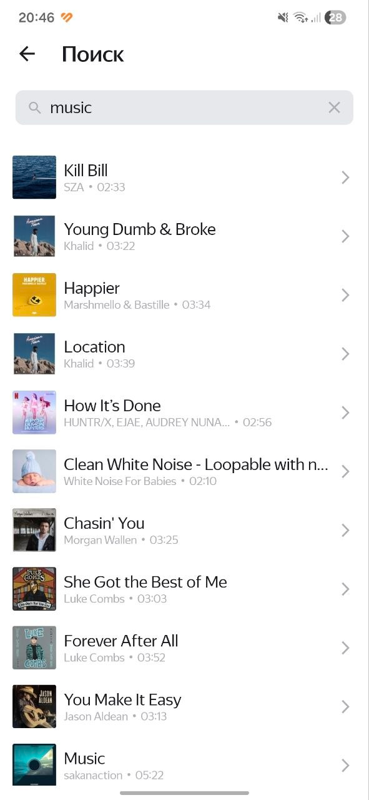

# 🎵 PlaylistMaker

Android-приложение для поиска, прослушивания и управления собственной музыкальной коллекцией. Позволяет находить композиции через iTunes Search API, прослушивать аудиофрагменты, сохранять любимые треки и создавать персональные плейлисты. Особое внимание уделено работе с локальной музыкальной библиотекой, хранению пользовательских данных и управлению воспроизведением.

Проект построен на принципах Clean Architecture с использованием MVVM.

## Скриншоты

<p align="center">
  
  
  
  
</p>

## Основные возможности

### Поиск музыки
получение информации о композициях через iTunes Search API, обработка поисковых запросов с задержкой и сохранение истории поиска.
### Аудиоплеер
воспроизведение доступных фрагментов композиций, управление воспроизведением и отображение информации о текущем треке.

### Музыкальная библиотека
добавление и удаление композиций из избранного с сохранением данных в локальной базе Room.

### Пользовательские плейлисты
создание и редактирование плейлистов, добавление и удаление треков, сохранение обложек и описаний.

### Управление коллекцией
автоматический расчёт продолжительности плейлистов и возможность поделиться ими в текстовом формате.

### Настройки приложения
поддержка светлой и тёмной тем, а также дополнительные пользовательские разделы.

## Архитектура

В проекте используется **Clean Architecture** в сочетании с **MVVM**.

Приложение разделено на три основных слоя:

- **Data Layer** — сетевые запросы через Retrofit, локальная база данных Room, SharedPreferences, файловое хранилище обложек и взаимодействие с MediaPlayer.
- **Domain Layer** — модели предметной области, интерфейсы репозиториев и интеракторы, содержащие бизнес-логику.
- **Presentation Layer** — Activity, Fragment, ViewModel, LiveData и модели состояний интерфейса.

Зависимости внедряются через Koin, за изменениями данных в Room следят Flow.

Подробнее: [Архитектура приложения](docs/architecture.md)

## Технологии

| Категория | Инструменты |
|---|---|
| Язык и платформа | Kotlin, Android SDK |
| Минимальная версия Android | minSdk 29 |
| UI | XML, ViewBinding, Activity, Fragment |
| Навигация | Navigation Component, BottomNavigationView, ViewPager2, TabLayout |
| Архитектура | Clean Architecture, MVVM |
| Управление состоянием | ViewModel, LiveData |
| Асинхронность | Kotlin Coroutines, Flow |
| Сеть | Retrofit 2, Gson, REST API, iTunes Search API |
| Локальное хранение | Room, SQLite, SharedPreferences |
| Воспроизведение | MediaPlayer |
| Dependency Injection | Koin |
| Работа с изображениями | Glide |
| Мониторинг ошибок | Firebase Crashlytics |

## Сборка и запуск

1. Клонируйте репозиторий и перейдите на ветку `dev`:

   ```bash
   git clone -b dev https://github.com/bezFantazee/PlaylistMaker.git
   cd PlaylistMaker
   ```

2. Откройте проект в Android Studio и дождитесь завершения Gradle Sync.

3. Соберите Debug-версию:

   **Linux / macOS**
   ```bash
   ./gradlew assembleDebug
   ```

   **Windows**
   ```bat
   gradlew.bat assembleDebug
   ```

4. Для установки на подключённое устройство или запущенный эмулятор:

   **Linux / macOS**
   ```bash
   ./gradlew installDebug
   ```

   **Windows**
   ```bat
   gradlew.bat installDebug
   ```

## Планы развития

Текущие идеи по развитию приложения собраны в [Roadmap](docs/roadmap.md). В частности, рассматриваются улучшение навигации и расширение возможностей медиатеки.
